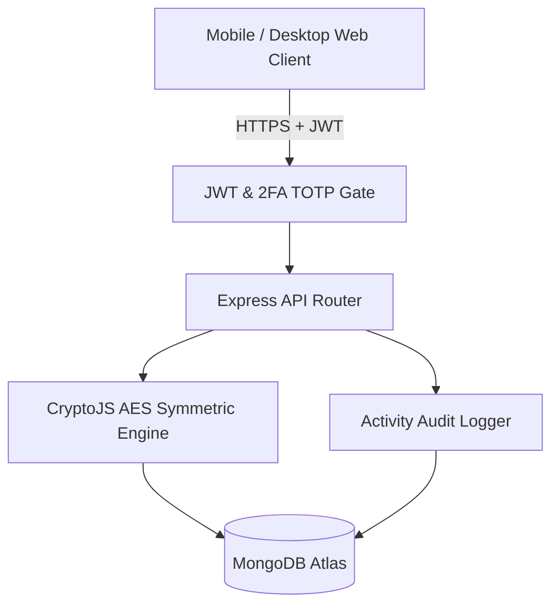

# CipherNest v2 (Mobile-Ready Cybersecurity Platform)

[](https://github.com/yashpatadiya1724-cmyk/ciphernest-v3-railway/actions/workflows/ci.yml)
[](https://nodejs.org/)
[](LICENSE)
[](https://github.com/sponsors/yashpatadiya1724-cmyk)

Mobile-first cybersecurity platform featuring server-side AES encrypted credential storage, 2FA authentication, and web security vulnerability scanners.

[Live demo](TODO: owner to add) | [Docs](docs/DESIGN.md) | [Security Policy](docs/SECURITY.md) | [Sponsor](https://github.com/sponsors/yashpatadiya1724-cmyk) | [License](LICENSE)

---

## Features
- **Server-Side Encrypted Vault:** AES block cipher encryption with unique random initialization vectors and salts for stored credentials.
- **Two-Factor Authentication (2FA):** RFC 6238 Time-Based One-Time Password (TOTP) support compatible with Google Authenticator and Authy.
- **Web Vulnerability Scanning:** Automated header audits for Content Security Policy (CSP), HTTP Strict Transport Security (HSTS), and SSL configuration.
- **Activity & Access Audit Log:** Comprehensive immutable timeline tracking user credential accesses and administrative operations.
- **Mobile-First Responsive Dashboard:** Optimized for mobile browser access with bottom navigation and real-time Socket.io alerts.

## Tech Stack
- **Frontend:** React, Vite, Tailwind CSS, Lucide Icons
- **Backend:** Node.js, Express, Socket.io, CryptoJS, otplib, systeminformation
- **Database:** MongoDB (Atlas / Mongoose)
- **Deployment:** Railway, Nixpacks, Vercel, GitHub Actions CI/CD

## Architecture



## Getting Started

### Prerequisites
- Node.js 20+
- MongoDB instance (local or MongoDB Atlas)

### Setup
1. Clone the repository:
   ```bash
   git clone https://github.com/yashpatadiya1724-cmyk/ciphernest-v3-railway.git
   cd ciphernest-v3-railway
   ```

2. Copy environment template:
   ```bash
   cp .env.example .env
   cp .env.example backend/.env
   ```

3. Install dependencies:
   ```bash
   npm run install:all
   ```

4. Start development server:
   ```bash
   cd backend && npm run dev
   ```

5. Run test suite:
   ```bash
   cd backend && npm test
   ```

## Environment Variables

| Variable | Purpose |
|---|---|
| `PORT` | Backend API server listening port (default: `5000`) |
| `NODE_ENV` | Application environment (`development` / `production`) |
| `MONGODB_URI` | MongoDB database connection URI string |
| `JWT_SECRET` | Master key used for JWT signing and server-side AES vault encryption |
| `AI_PROVIDER` | AI threat advisory provider (`gemini` or `groq`) |
| `GEMINI_API_KEY` | Google Gemini API key for threat remediation intelligence |
| `GROQ_API_KEY` | Groq Cloud API key (optional alternative) |
| `GROQ_MODEL` | Groq model identifier (`llama-3.3-70b-versatile`) |

## Security and Privacy
- **What is Encrypted:** Secret credential values are encrypted using symmetric AES (via CryptoJS) prior to database insertion.
- **Where Keys Live:** The encryption key resides strictly in server-side memory derived from the `JWT_SECRET` / `ENCRYPTION_KEY` environment variable.
- **Known Limitations (Honest Posture):** This is a **server-side encrypted vault**, not a client-side zero-knowledge system. The server holds the encryption key to decrypt secrets on authorized requests; anyone with administrative access to server runtime environment variables and database backups could theoretically read stored secrets.
- **Secrets Logging Policy:** Plaintext secrets, private keys, and user master credentials are never logged, printed to stdout, or exposed in error stack traces.
- **Security Policy:** Full disclosure guidelines and vulnerability SLAs are documented in [docs/SECURITY.md](docs/SECURITY.md).

## Roadmap
- [x] Server-side AES encrypted vault
- [x] RFC 6238 2FA TOTP implementation
- [x] Railway one-click deployment configuration
- [ ] Client-side WebCrypto PBKDF2 zero-knowledge key derivation
- [ ] Automated CVE vulnerability database sync

## What I Learned
- Cybersecurity platforms must maintain absolute honesty about cryptographic boundaries. Calling a server-side encrypted vault "zero-knowledge" misrepresents the threat model.
- Managing 2FA compatibility requires defensive multi-version support (supporting both otplib v12 and v13 authenticator exports).

## Author
Yash Patadiya: [LinkedIn](https://www.linkedin.com/in/yash-patadiya-973161272/)

## License
MIT
