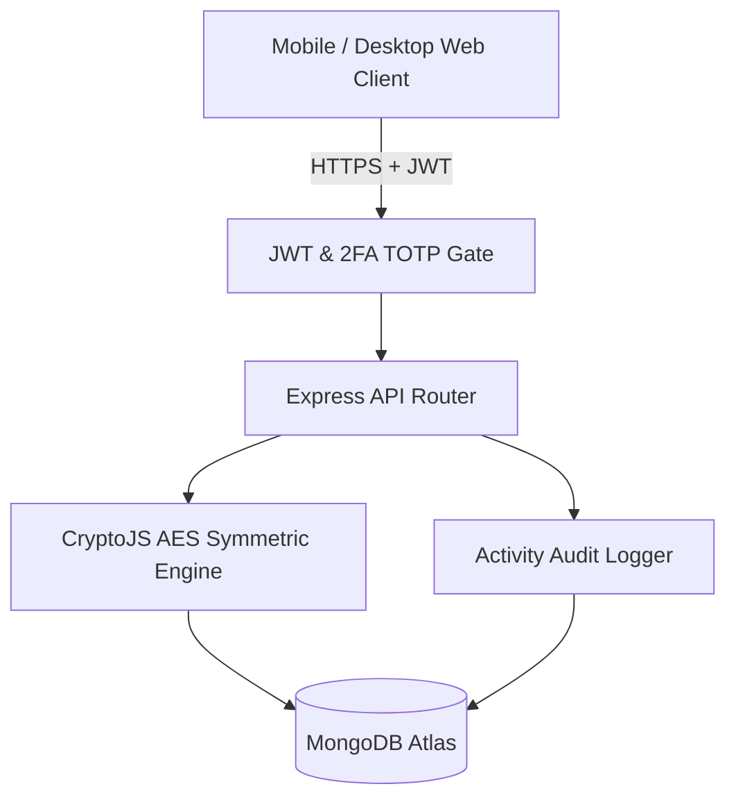

# CipherNest v2 (Mobile-Ready Cybersecurity Platform)

Mobile-first cybersecurity platform featuring server-side AES encrypted credential storage, 2FA authentication, and web security vulnerability scanners.

[Live Demo](TODO: add live link) | [Docs](docs/DESIGN.md) | [License](LICENSE)

---

## Features
- **Server-Side Encrypted Vault:** AES block cipher encryption with unique random initialization vectors and salts for stored credentials.
- **Two-Factor Authentication (2FA):** RFC 6238 Time-Based One-Time Password (TOTP) support compatible with Google Authenticator and Authy.
- **Web Vulnerability Scanning:** Automated header audits for Content Security Policy (CSP), HTTP Strict Transport Security (HSTS), and SSL configuration.
- **Activity & Access Audit Log:** Comprehensive immutable timeline tracking user credential accesses and administrative operations.
- **Mobile-First Responsive Dashboard:** Optimized for mobile browser access with bottom navigation and real-time Socket.io alerts.

## Tech Stack
- **Frontend:** React, Vite, Tailwind CSS, Lucide Icons
- **Backend:** Node.js, Express, Socket.io, CryptoJS, otplib, systeminformation
- **Database:** MongoDB (Atlas / Mongoose)
- **Deploy:** Railway, Nixpacks, GitHub Actions CI/CD

## Architecture



## Getting Started

### Prerequisites
- Node.js 20+
- MongoDB instance (local or MongoDB Atlas)

### Installation
1. Clone the repository:
   ```bash
   git clone https://github.com/yashpatadiya1724-cmyk/ciphernest-v3-railway.git
   cd ciphernest-v3-railway
   ```

2. Copy environment template:
   ```bash
   cp .env.example .env
   cp .env.example backend/.env
   ```

3. Install dependencies:
   ```bash
   cd backend
   npm install
   ```

4. Run automated test suite:
   ```bash
   npm test
   ```

5. Run development server:
   ```bash
   npm run dev
   ```

## API Endpoints

| Method | Endpoint | Description |
|---|---|---|
| `POST` | `/api/auth/register` | Register new user account |
| `POST` | `/api/auth/login` | Authenticate user & issue JWT |
| `GET` | `/api/2fa/setup` | Generate TOTP secret and QR code |
| `POST` | `/api/2fa/verify` | Validate 6-digit TOTP token and activate 2FA |
| `GET` | `/api/secrets` | Retrieve user secrets list (sanitized, values not decrypted) |
| `POST` | `/api/secrets` | Encrypt and store new credential |
| `POST` | `/api/tools/web-scan` | Perform security header and SSL scan on target URL |

## Security and Privacy
- **Encrypted at Rest:** Credentials in the vault are encrypted using AES before insertion into MongoDB.
- **Known Limitations (Honest Posture):** This is a **server-side encrypted vault**, not a zero-knowledge architecture. The backend manages the master key; anyone with direct access to server environment variables and the database could theoretically decrypt stored values. Production deployments require secure secret management (e.g., AWS KMS or HashiCorp Vault).

## Roadmap
- [x] Server-side AES encrypted vault
- [x] RFC 6238 2FA TOTP implementation
- [x] Railway one-click deployment configuration
- [ ] Client-side WebCrypto PBKDF2 zero-knowledge key derivation
- [ ] Automated CVE vulnerability database sync

## What I Learned
- Cybersecurity platforms must maintain absolute honesty about cryptographic boundaries. Calling a server-side encrypted vault "zero-knowledge" misrepresents the threat model.
- Library version upgrades in security stacks (like otplib v12 to v13) require defensive wrappers to avoid breaking production authentication flows.

## License
MIT
